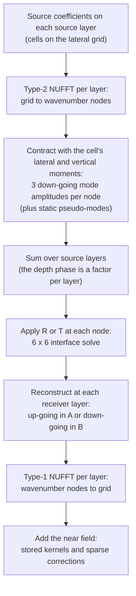

# Near Field in Space, Far Field in Wavenumber

**17 October 2026.** An explanatory note. It describes the operator as built on `main` at `d1b48b4` and changes
nothing.

It explains three things:

1. why the self and near field of the interface coupling are computed in the spatial domain, from closed forms;
2. how the rest of the field is computed in the wavenumber domain, as up-going and down-going waves;
3. which numerical devices make the oscillatory wavenumber integrals cheap, how they compare with the
   classical toolbox (Filon, modified Clenshaw–Curtis, double-exponential rules), and what the literature of
   the last thirty years would add.

It closes with a ranked list of what to try next against the present bottleneck, the cost of one matrix-free
product.

Notation follows `LatexPDFs/InterfaceCouplingIntegrals` (the interface paper) and
`LatexPDFs/ExactCouplingIntegrals` (the whole-space paper): axes $(z, x, y)$ with $z$ down, time $e^{-i\omega t}$,
cubic cells of half-width $h$, medium A in $z < 0$ and medium B in $z > 0$, welded at $z = 0$.

---

## Summary

- **One block, two representations.** Every coupling block $\mathbf K_{ac}$ between two Legendre cells can be
  written either as a double volume integral of the $9 \times 9$ point propagator in space, or as a
  two-dimensional integral over lateral wavenumber of plane-wave modes. They are the same number.
- **The spatial form is used where the plane-wave form does not converge.** Cells in touching planes, and
  cells that touch their own mirror image at the interface, leave the plane-wave integrand with no
  exponential decay at all. For them the closed forms are not an option but a necessity.
- **The closed forms do a second job.** Their static ($\omega^0$) and $\omega^2$ parts are subtracted from the
  integrand and added back exactly. That turns a $Q^{-3}$ tail into $Q^{-6}$, so the wavenumber integral can
  stop at $Q_0 h = 10$ instead of about 400.
- **Everything else is plane waves.** Per lateral wavenumber, the coupling factorises in depth: project each
  source layer onto three down-going modes, apply the $6 \times 6$ reflection/transmission matrix, reconstruct
  at each receiver layer. The lateral sums are type-2 and type-1 non-uniform FFTs. Nothing of size
  $L^2 n^2$ is stored.
- **The quadrature devices already in the code are, almost all, the modern ones.** Branch-point panel ends
  with a square-root map, singularity subtraction, a smooth window, azimuthal harmonics, a spectral band
  split with Poisson summation, and exact small-$q$ product integration. Tanh-sinh and Filon add little on top.
- **The bottleneck is now the transforms, not the integrals.** The plan measures about 55 ms per 4096
  wavenumber nodes and 90 components, whatever the box. Most nodes lie on a *uniform* lattice, where a
  NUFFT is an expensive way of doing a zero-padded FFT. That is the first thing to change (Section 8).

---

## 1. The problem

The heterogeneity is divided into space-filling cubes. Each cell carries a polynomial (Legendre) state of
displacement and engineering strain, nine components per polynomial term. A Galerkin volume integral equation
couples the cells through blocks

$$
\mathbf K_{ac} = \iint L_a(\boldsymbol\xi)\,\mathbf P(\mathbf x - \mathbf x')\,m_c(\boldsymbol\xi')\,
\mathrm d^3x\,\mathrm d^3x' ,
$$

with $L_a$ the receiver cell's test function, $m_c$ the source cell's monomial, and $\mathbf P$ the $9 \times 9$
point propagator: the elastodynamic Green's tensor and up to two of its derivatives. With a welded interface,
$\mathbf P$ is the whole-space propagator plus a reflected part (both cells on one side) or is wholly a
transmitted part (cells on opposite sides).

The solver (Foldy–Lax / T-matrix form, $\mathbf T = \mathbf T_0(\mathbf I - \mathbf G_0 \mathbf T_0)^{-1}$) is run
by GMRES. All it needs from the coupling is the **product** of the block matrix with a vector. The whole
question of this note is how to form that product quickly and accurately.

---

## 2. Two representations of the same block

### 2.1 In space

In a homogeneous medium $\mathbf P$ depends on $\mathbf x - \mathbf x'$ only. The double cell integral collapses
to one integral over the separation $\mathbf s$ against a piecewise-polynomial weight (the cross-correlation
of the two cells' factors). The kernel is expanded as a power series in $r$, from
$e^{ikr}/r = \sum_t (ik)^t r^{t-1}/t!$, so each block becomes a finite sum of **universal moments** of $r^m$. The
odd powers are the singular ones. They are integrated exactly in a Legendre basis with Duffy pyramids.

At an interface, the static reflected and transmitted kernels (Rongved's problem) are sums of $356$ and $275$
terms of the form $z^A z'^B \partial^\alpha \Phi_j$, built on three potentials of the image distance
$\zeta = -(z + z')$:

$$
\Phi_0 = \frac{1}{2\pi R},\qquad
\Phi_1 = -\frac{\log(R + \zeta)}{2\pi},\qquad
\Phi_2 = \frac{\zeta \log(R + \zeta) - R}{2\pi}.
$$

The $\omega^2$ term adds 744 and 582 terms, with Hadamard finite parts. All of these closed forms are
verified to between $10^{-13}$ and $10^{-15}$ against 40 to 60 digit references.

### 2.2 In wavenumber

Write the lateral wavenumber as $\mathbf k = (k_x, k_y)$ and its magnitude as $q = |\mathbf k|$. For each wave
type $\nu \in \{\mathrm P, \mathrm{SV}, \mathrm{SH}\}$ of speed $c_\nu$,

$$
k_{z,\nu} = \bigl(\omega^2/c_\nu^2 - q^2\bigr)^{1/2}, \qquad \operatorname{Im} k_{z,\nu} \ge 0 .
$$

For $q < \omega/c_\nu$ the wave propagates; for $q > \omega/c_\nu$ it is evanescent and decays as
$e^{-\sqrt{q^2 - \omega^2/c_\nu^2}\,|z|}$. Between planes with $z - z'$ of one sign $\sigma$, the whole-space
propagator is Weyl's plane-wave sum

$$
\mathbf P(\mathbf x, \mathbf x') = \frac{1}{4\pi^2} \int_{\mathbb R^2} \sum_\nu w_\nu\,
\mathbf d_\nu^\sigma\, \mathbf d_\nu^{\sigma\mathsf T} \mathbf M\,
e^{i \mathbf k_\nu^\sigma \cdot (\mathbf x - \mathbf x')}\,\mathrm d^2k,
\qquad w_\nu = \frac{i}{2\rho c_\nu^2 k_{z,\nu}},
$$

with $\mathbf d_\nu^\sigma$ the mode's nine-component state (displacement and engineering strain) and
$\mathbf M$ the pairing of stress-like source entries with strain-like state entries. Each cell then enters
only through its Fourier moment, which is in closed form for complex arguments:

$$
\Lambda_a(\boldsymbol\kappa) = h^3 \prod_i 2\, i^{\,l_{a,i}} j_{l_{a,i}}(h\kappa_i),
$$

with $j_l$ the spherical Bessel functions. So a block becomes

$$
\mathbf K_{ac} = \frac{1}{4\pi^2}\int_{\mathbb R^2}\sum_\nu w_\nu\,
\Lambda_a(\mathbf k_\nu^\sigma)\,\mu_c(-\mathbf k_\nu^\sigma)\,
\mathbf d_\nu^\sigma \mathbf d_\nu^{\sigma\mathsf T}\mathbf M\,
e^{i\mathbf k_\nu^\sigma\cdot(\mathbf x_m - \mathbf x_n)}\,\mathrm d^2k .
$$

The interface enters through the reflection and transmission coefficients $R_{\mu\nu}(\mathbf k)$ and
$T_{\mu\nu}(\mathbf k)$, from a $6 \times 6$ continuity system at each $\mathbf k$ (Kennett). Because the
lateral wavenumber is conserved across the interface, nothing else changes. The reflected term's vertical
phase is

$$
e^{i(k_{z,\mu}|z| + k_{z,\nu}|z'|)} ,
$$

so its evanescent decay is set by the receiver's distance from the source's **mirror image**
$(-z', x', y')$.

---

## 3. Why the self and near field are computed in space

### 3.1 The plane-wave integral does not converge for touching cells

Look at the integrand at large $q$, where every mode is evanescent and $k_z \approx iq$.

- **The receiver's moment** over its vertical extent $[z_m - h, z_m + h]$ contains $e^{-q(z - z_m)}$, which
  grows to $e^{qh}$ at the cell's near face.
- **The source's moment** grows the same way, by $e^{qh}$.
- **Propagation** between the two centres contributes $e^{-q|z_m - z_n|}$.

The net vertical factor is

$$
e^{-q\,(|z_m - z_n| - 2h)} .
$$

For two cells in **touching planes**, $|z_m - z_n| = 2h$, the exponent is zero. Nothing decays. What is left
decays at most algebraically through the lateral moments, while the strain components (two derivatives)
grow like $q^2$. The integral does not converge. Numerically, errors of order $10^2$ appear.

For planes $g$ cell-widths apart, $|z_m - z_n| = 2gh$ and the integrand falls as $e^{-2(g-1)qh}$. One plane
apart is already $e^{-2qh}$; three apart is $e^{-4qh}$, and $q h = 8$ is then enough for $10^{-14}$.

At the interface the same argument applies with the mirror image in place of the source. **A cell touching
the interface touches its own image**, so its reflected self-block has no decay either.

### 3.2 What this means physically

The point propagator is singular at $r = 0$: like $1/r$ for displacement and like $1/r^3$ after two
derivatives. A singularity in space is a slowly decaying spectrum in wavenumber. The singular behaviour is
confined to short range, so the cure is to treat short range where the singularity is visible and
integrable: in space. The closed forms do exactly that, with Duffy pyramids and finite parts, and they do it
to rounding.

### 3.3 The closed forms' second job: singularity subtraction

Even where the plane-wave integral converges, its tail is the far tail of the static singularity, falling
like $Q^{-3}$. The interface operator therefore splits each block as

$$
\mathbf K(\omega) = \mathbf D(\omega) + \mathbf A_0 + \omega^2 \mathbf A_1 + \mathbf E,
$$

- $\mathbf D = \tfrac{1}{4\pi^2}\int_{q<Q_0} \bigl[\mathbf Y - \chi\,(\mathbf Y_0 + \omega^2\mathbf Y_1)\bigr]\,\mathrm d^2k$,
  computed per frequency;
- $\mathbf A_0 = \mathbf K_0 - \tfrac{1}{4\pi^2}\int (1-\chi)\,\mathbf Y_0\,\mathrm d^2k$, computed once, $\mathbf K_0$ the
  static block in closed form;
- $\mathbf A_1 = \tfrac{1}{4\pi^2}\int \chi\,\mathbf Y_1\,\mathrm d^2k$, computed once;
- $\mathbf E$, dropped, of order $Q_0^{-6}$.

Here $\mathbf Y$ is the plane-wave integrand, $\mathbf Y_0$ and $\mathbf Y_1$ its static and $\omega^2$ terms, and
$\chi$ a smooth high-pass window. This is Kummer's method, applied to a Sommerfeld-type integral. It buys:

- **a short integral:** the tail goes from $Q^{-3}$ to $Q^{-5}$ with $\mathbf K_0$ and to $Q^{-6}$ with
  $\mathbf K_1$, so $Q_0 h = 10$ replaces $Qh \approx 400$;
- **frequency independence:** $\mathbf A_0$ and $\mathbf A_1$ are reused at every frequency and every incidence;
- **an independent arbiter:** the closed forms share no step with the wavenumber route, and every gate in
  the series rests on that.

Measured remainder for a cell touching the interface and its own image: $\mathbf E \approx 4\times10^{-10}$ of
the block at $Q_0 h = 10$ when $\omega h/\beta = 1/6$, and $\approx 6\times10^{-11}$ at $Q_0 h = 40$ when
$\omega h/\beta = 1$.

### 3.4 What "near" means in the operator today

| Part | Domain | How applied |
|---|---|---|
| Whole space, planes 0 to 2 apart | space (closed forms) | stored lateral kernels, $5(2n-1)^2$ blocks per side |
| Whole space, planes 3 or more apart | wavenumber | depth march, `stratified_apply.WholeSpaceMarch` |
| Interface corrections $\mathbf A_0$, $\mathbf A_1$ | space minus a low-passed spectrum | sparse local blocks within lateral and depth radii |
| Interface plane-wave part $\mathbf D$ | wavenumber | NUFFT product, `stratified_apply.TwoSidedProduct` |

The smooth window is what makes the third row *local*. With a sharp cutoff, $\mathbf A_0$ and $\mathbf A_1$ ring
in space (the Gibbs phenomenon) and decay slowly with lateral offset; with a $C^\infty$ step they decay quickly
and can be truncated at a radius.

---

## 4. How the rest of the field is computed in wavenumber

### 4.1 The product, step by step

### 4.2 Why it factorises: up-going and down-going waves

At a fixed lateral wavenumber, the reflected coupling between a source at depth $z_s$ and a receiver at
$z_r$ is

$$
\mathbf F(\mathbf k) = \sum_{m,n} \mathbf U(z_r;\mathbf k)_{m}\, R(\mathbf k)_{mn}\, \mathbf V(z_s;\mathbf k)_{n},
$$

a sum over three down-going source modes and three up-going (reflected) or down-going-in-B (transmitted)
receiver modes. The source enters only through $\mathbf V(z_s)$, the receiver only through
$\mathbf U(z_r)$. So per node the operator has **rank at most three per side**. A product never needs a block
for a pair of depths:

1. project every source layer onto its mode amplitudes and sum over layers;
2. apply $R$ or $T$;
3. reconstruct at every receiver layer.

Memory goes as nodes $\times$ layers, not $L^2 (2n)^2$. That is what removes the 0.8 TB per frequency that
stored kernels would need at $100 \times 100 \times 20$ cells.

The whole-space part separates the same way once $z_r > z_s$ and $z_r < z_s$ are taken apart: down-going
waves are marched down the stack and up-going waves up it, with the vertical phase stepped one layer at a
time.

### 4.3 Two bands of the spectrum

The plane-wave part $\mathbf D$ is split again, at a smooth partition $\psi(q)$ between twice the highest
branch point (at least $0.35/h$) and $2.5/h$:

- **The low band** contains the branch circles $q = \omega/c_\mathrm P$ and $q = \omega/c_\mathrm S$ and carries
  the interface waves, whose kernel decays only like $h/r$. A periodic box would wrap that tail onto itself:
  an image at distance $P$ costs about $h/P$, so $10^{-8}$ would need $P \sim 10^8 h$. The low band is
  therefore integrated on a **polar quadrature**, non-periodic, and applied by genuine non-uniform FFTs.
- **The high band** lies above every branch point. Its spectrum is smooth, so its kernel decays faster than
  any power of $r$. It is sampled on the **uniform lattice of a periodic box** padded by about 40 cells, and by
  Poisson summation that sample is exactly the periodised kernel. Its images are negligible.

---

## 5. The numerical devices, one by one

Each entry gives the difficulty, the device, and where it lives.

| # | Difficulty | Device | Where |
|---|---|---|---|
| 1 | Square-root branch points at $q = \omega/c$ ($1/k_z$ in $w_\nu$) | Branch points as panel ends; on each adjacent panel the map $q = b - b\,t^2$ makes the integrand analytic in $t$; Gauss–Legendre of order 24 there, order 12 on plain panels | `interface_spectral.radial_rule` |
| 2 | Polarisations undefined past the branch point | Unit vectors in the bilinear sense, $\mathbf e\cdot\mathbf e = 1$, which continue analytically into the evanescent range; $\operatorname{Im}k_z \ge 0$ fixed once | interface paper, Section 2; `sweep_kernels._branch` |
| 3 | Slow $Q^{-3}$ tail from the static singularity | Subtract $\mathbf Y_0 + \omega^2\mathbf Y_1$ and add the closed forms back (Kummer): tail $Q^{-6}$ | Section 3.3; `interface_spectral` header |
| 4 | A sharp cutoff makes the corrections ring in space | $C^\infty$ window $\chi$ (or a $C^k$ polynomial step) | `interface_spectral.Window` |
| 5 | The 2-D integrand depends on direction through $9\times9$ rotations | Rotate to the frame of $\mathbf k$: only harmonics $e^{in\phi}$, $\lvert n\rvert \le 4$, survive; the azimuthal integrals $S_n(q)$ of the lateral moments and phase are tabulated once per offset as piecewise Chebyshev series, independent of frequency, media and depth | `interface_spectral.lateral_harmonics` |
| 6 | Azimuthal integration | Trapezoid rule, spectrally accurate for periodic integrands; $n_\phi = 4\lceil(4qh + 2qh\,\mathrm{reach} + 64)/4\rceil$ resolves the phase over the lateral reach | `interface_spectral._n_phi` |
| 7 | Singular $q^{-N}$ behaviour of the static and $\omega^2$ integrands at $q \to 0$ | Product integration: every factor is an exact power series in $q$ near 0, so each power and harmonic is integrated exactly, with finite parts by continuation in the power (the $q^{-1}$ term gives $\log q_s$); Gauss panels beyond $q_s$ | `interface_lateral.head`, `interface_spectral.fp_low_integral` |
| 8 | Long-range low band against short-range high band | Spectral band split: polar quadrature plus NUFFT below, uniform lattice plus Poisson summation above | Section 4.3; `stratified_apply` |
| 9 | $L^2$ depth pairs | Rank $\le 3$ per node and side: project, apply $R/T$, reconstruct | Section 4.2; `stratified_apply.mode_factors` |
| 10 | Whole-space coupling between distant planes | Depth march; from gap 3 the integrand falls as $e^{-4qh}$, so the lattice stops at $qh = 8$ | `stratified_apply.WholeSpaceMarch` |
| 11 | Cell integrals | Closed-form Fourier moments (spherical Bessel functions) for complex arguments; no quadrature over the cells | interface paper, Eqs. for $\Lambda_a$, $\mu_c$ |

Device 7 deserves a remark: it **is** Filon's idea. The non-smooth factor ($q^{-N}$ and the logarithm) is
integrated exactly against a polynomial fit of the smooth rest. It is product integration in the sense of
Filon and of Piessens and Branders.

---

## 6. Is the classical toolbox still the right one?

### 6.1 Double-exponential (tanh-sinh) rules

Tanh-sinh is the right tool when an endpoint singularity is of **unknown** type. At the branch points the
type is known exactly: a square root. The quadratic map of device 1 removes it completely, so Gauss–Legendre
then converges exponentially with far fewer nodes than a double-exponential rule. The substitution
$q\,\mathrm dq/k_z = -\mathrm dk_z$ achieves the same thing in another way. **Verdict:** keep the quadratic map.
Reserve double-exponential rules for references at high precision (`NIntegrate` with
`Method -> "DoubleExponential"`) and for any new singularity whose exponent is not known in advance.

### 6.2 Filon and modified Clenshaw–Curtis

Filon's method pays when a smooth amplitude multiplies an oscillation **that the quadrature must integrate
through**. In the product here, the oscillation $e^{i\mathbf k\cdot(\mathbf x_m - \mathbf x_n)}$ is never
integrated by quadrature. The NUFFT evaluates it **exactly** at every node for every target. What the nodes
must still do is resolve it: the azimuthal count grows with the lateral reach (device 6). A Filon weight would
depend on the target offset, and in two dimensions that does not factor through a single transform. So
Filon cannot reduce the node count of the NUFFT product.

Where Filon's idea does pay, it is already in use:

- as product integration at small $q$ (device 7);
- as the tabulation of $S_n(q)$ by Chebyshev series (device 5).

If per-offset radial integrals at large lateral offsets return (they no longer drive the product), the modern
form is **Filon–Clenshaw–Curtis** against Bessel weights $J_n(q\rho)$, or **Levin collocation**.

### 6.3 Why the Chebyshev moment recurrences were unstable, and the cure

In Piessens and Branders' modified Clenshaw–Curtis, the moments
$M_n(\omega) = \int_{-1}^{1} T_n(t)\,e^{i\omega t}\,\mathrm dt$ were generated by a three-term recurrence in $n$.

- **The cause:** for $n > \omega$, the wanted moments are the *minimal* (decaying) solution of that
  recurrence. Run forwards, any rounding error excites the dominant solution, which swamps them.
- **QUADPACK's QAWO** (1983) applies the standard cure: it runs the recurrence forwards only while that is
  stable, and otherwise solves it as a boundary-value problem (Oliver's method).
- **A recurrence-free alternative** is the Jacobi–Anger expansion

  $$
  e^{i\omega t} = J_0(\omega) + 2\sum_{m\ge1} i^m J_m(\omega)\,T_m(t),
  $$

  which gives $M_n = \sum_m \varepsilon_m i^m J_m(\omega)\int_{-1}^1 T_n T_m\,\mathrm dt$. Here $\int T_nT_m$
  vanishes when $n + m$ is odd and equals $1/(1-(n+m)^2) + 1/(1-(n-m)^2)$ when it is even. The Bessel values
  come from Miller's backward recurrence. The plan already proposes Jacobi–Anger for the low band's $S_n$
  tables.
- **The analysis** of Filon–Clenshaw–Curtis, with frequency-uniform error bounds when the moments are computed
  stably, is due to Domínguez, Graham and Smyshlyaev (2011).

### 6.4 Sommerfeld integrals: the last thirty years

| Method | Idea | Fit here |
|---|---|---|
| Contour deformation | Leave the real $q$ axis for a path in the complex plane that avoids branch points and poles; the integrand becomes smooth and decaying | Good for per-offset radial integrals (with $J_n = \tfrac12(H_n^{(1)} + H_n^{(2)})$). **Not compatible with the NUFFT product**, which needs real $\mathbf k$ |
| Tail extrapolation (weighted averages, Michalski and Mosig) | Accelerate the alternating partial integrals of a slowly converging tail | Unnecessary: singularity subtraction (device 3) has already removed the tail |
| Quasi-static extraction | Subtract the asymptotic integrand and add back its closed form | Already done, to second order in $\omega$ (device 3) |
| Discrete complex images (DCIM) | Fit $R(q)$ by a sum of exponentials, so the reflected field becomes a few whole-space Green's functions from complex image points | Poor fit: DCIM is known to lose accuracy at large lateral range, exactly where the $h/r$ interface waves live, and the closed forms would need continuation to complex depths |
| Layered-media fast multipole methods | Sommerfeld-type expansions for the far field, direct evaluation in the near field: the same split as here | For cells on a regular lattice, FFTs are faster and simpler than an FMM tree. Worth revisiting only for irregular or adaptive cells |
| Windowed Green function | Truncate the layered-medium Green's function smoothly in space | Changes the kernel the solve needs; the plan's own measurement shows tapers do not help for $h/r$ tails |
| Non-uniform FFTs (Dutt and Rokhlin; Greengard and Lee; FINUFFT, cuFINUFFT) | Sums over arbitrary nodes in $O(N\log N)$ at a chosen tolerance | In use; see Section 8 for how to use them more cheaply |

**Interface (Stoneley) poles.** A welded interface can carry a Stoneley wave for some contrasts. It puts a
real-axis pole into $R(q)$ beyond $\omega/\beta$. The plan records that the media tested so far have none:
$\lvert R\rvert$ is smooth there and peaks only at the branch points. **That holds for those media only.** A
production run over other contrasts should check for a pole and, if one exists, take its residue apart or
indent the path.

---

## 7. Where the time goes now

From `docs/2026-10-15-interface-solver-scaling-plan.md` (S5):

- **The product is the NUFFTs.** About 55 ms per 4096 nodes and 90 components, whatever the box.
- **The node count is set by the padded lattice**, not the box. The high band has about
  $\pi(Q_0 N h/\pi)^2$ nodes with $N$ = box + 41 cells: about 93k per side at 288 cells.
- **Per-product times** run from tens of seconds to minutes. With planes up to 2 apart stored and the march
  from gap 3 to $qh = 8$: 24.7 s per product for 96 cells in six layers.

The cost per node is fixed; what has to change is the number of nodes that go through a non-uniform
transform, and the cost of each.

---

## 8. What to try next, ranked

### 8.1 Replace the NUFFT by a zero-padded FFT on the uniform lattice

`high_band_nodes` and the upper part of `whole_space_nodes` place their nodes at
$k_x = m\,\Delta k$, $k_y = m'\,\Delta k$ with $\Delta k = 2\pi/(n_\mathrm{grid}\cdot 2h)$: a uniform lattice,
each Brillouin-zone alias its own node. On the cell grid $x_j = 2hj$ the phase is
$e^{-2\pi i\,mj/n_\mathrm{grid}}$, and aliases $m$ and $m + n_\mathrm{grid}$ give the same phase.

- **Type 2 (grid to nodes):** one zero-padded FFT of size $n_\mathrm{grid}^2$ per layer and component gives every
  node exactly, aliases included, by indexing $m \bmod n_\mathrm{grid}$.
- **Type 1 (nodes to grid):** after the per-node $R/T$ multiply, fold the node data by $m \bmod n_\mathrm{grid}$
  (sum the aliases) and take one inverse FFT.

Expected effect:

- **No spreading, no tolerance:** the result is exact to rounding, so this also removes one error source
  from the gate.
- **Much cheaper transforms:** an FFT of $53^2$ points (288 cells) is far below a millisecond per component,
  against 55 ms per 4096-node chunk.
- **What remains:** the per-node mode algebra, still proportional to the node count.

Measure the share of lattice nodes against polar nodes first. The plan's counts suggest the lattice
dominates.

### 8.2 Tie the NUFFT tolerance to the error budget

The genuinely non-uniform nodes (the low band's polar quadrature) still need FINUFFT. Its spreading kernel
width is about $w = \lceil\log_{10}(1/\varepsilon)\rceil + 1$ points, and the 2-D spreading cost grows as
$w^2$.

| $\varepsilon$ | $w$ | Spreading cost against today |
|---|---|---|
| $10^{-11}$ (today) | 12 | 1 |
| $10^{-8}$ | 9 | about 0.56 |
| $10^{-6}$ | 7 | about 0.34 |

Decision D1 proposes a block tolerance of $10^{-6}$, two orders below the discretisation error of about
$2\times10^{-4}$. The transforms should follow D1, not the rounding floor. The gates can keep a run at
$10^{-11}$ for comparison with the stored kernels.

### 8.3 Fewer, larger transforms

Each 4096-node chunk calls `setpts` and then one execute per source layer and per receiver layer. Each execute
repeats the FFT stage on the oversampled grid. Two changes amortise that:

- **stack the layers into `n_trans`**, one execute per chunk instead of one per layer;
- **use larger chunks**, or one chunk with factors computed on the fly, as memory allows.

### 8.4 Retune the quadrature to the budget

The radial Gauss orders (24 next to the branch points, 12 elsewhere) and the floor of 64 in $n_\phi$ were set
for agreement at $10^{-10}$ to $10^{-12}$. At a block tolerance of $10^{-6}$, smaller orders and a smaller
floor will do. Gate each change against the stored-kernel product.

### 8.5 Move the transforms to the GPU

cuFINUFFT, and plain cuFFT once 8.1 is done, run on the remote GPU server. The per-node mode algebra is
batched small dense linear algebra and suits the GPU as well.

### 8.6 Decide D2

If $\mathbf K_0$ alone with a larger $Q_0$ meets the budget, $\mathbf K_1$ can leave production. That shortens the
set-up, not the product.

---

## 9. Further reading

These are for orientation; check details before citing them in a paper.

- **Representations and layered media:**
  - H. Weyl (1919), the plane-wave expansion of the spherical wave.
  - A. Sommerfeld (1909), the dipole over a half-space.
  - B. L. N. Kennett (1983), *Seismic Wave Propagation in Stratified Media*.
- **Oscillatory quadrature:**
  - L. N. G. Filon (1928).
  - C. W. Clenshaw and A. R. Curtis (1960).
  - R. Piessens and M. Branders (1970s), modified Clenshaw–Curtis.
  - R. Piessens, E. de Doncker-Kapenga, C. Überhuber and D. Kahaner (1983), *QUADPACK*.
  - D. Levin (1982).
  - A. Iserles and S. P. Nørsett (2005).
  - D. Huybrechs and S. Vandewalle (2006), numerical steepest descent.
  - V. Domínguez, I. G. Graham and V. P. Smyshlyaev (2011), stability of Filon–Clenshaw–Curtis.
  - A. Deaño, D. Huybrechs and A. Iserles (2018), *Computing Highly Oscillatory Integrals*.
- **Double-exponential rules:** H. Takahasi and M. Mori (1974).
- **Sommerfeld integrals in layered media:**
  - K. A. Michalski and J. R. Mosig (1997), multilayered-media Green's functions.
  - K. A. Michalski and J. R. Mosig (2016), Sommerfeld integral tails.
  - Y. L. Chow, J. J. Yang, D. G. Fang and G. E. Howard (1991), discrete complex images.
- **Fast methods:**
  - A. Dutt and V. Rokhlin (1993).
  - L. Greengard and J.-Y. Lee (2004).
  - A. H. Barnett, J. Magland and L. af Klinteberg (2019), FINUFFT.
  - Fast multipole methods for Helmholtz problems in layered media (B. Wang, W. Zhang, W. Cai and co-authors,
    from about 2019).
  - O. P. Bruno and co-authors (2016), the windowed Green function method for layered media.
